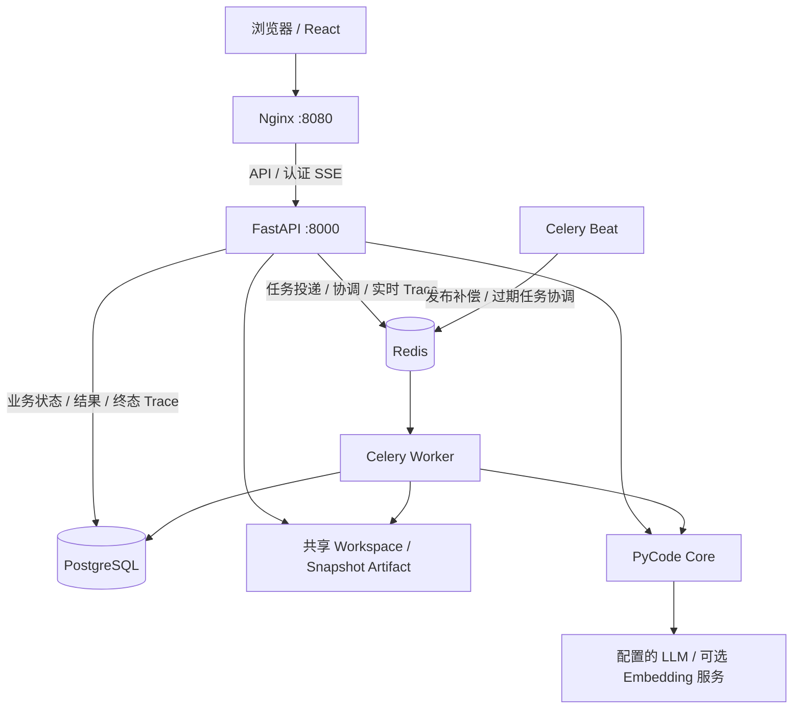

# PyCode

**v3.0 · 面向 Python 代码仓库的 AI 代码理解与分析系统**

PyCode 将静态结构化分析、Code Graph、Hybrid RAG 和 Agent 执行机制结合起来，为仓库问答、调用关系查询和影响分析提供可追溯的代码证据。适合阅读陌生项目、定位实现、梳理依赖，以及分析修改可能涉及的文件。

系统先把确定 Git commit 的源码构建为 Index、Graph 和 Chunk，再围绕问题选择证据交给模型，控制上下文范围并保留来源。React Web UI 提供项目管理、统一问答、执行 Trace、分析历史和局部图谱；Python Core 与 CLI 也可独立使用。

[核心功能](#核心功能) · [v3.0 主要升级](#v30-主要升级) · [系统架构](#系统架构) · [关键技术设计](#关键技术设计) · [Web 功能与使用流程](#web-功能与使用流程) · [Docker 快速开始](#docker-compose-快速开始) · [本地开发](#本地开发) · [技术栈与项目结构](#技术栈与项目结构) · [测试与质量保障](#测试与质量保障) · [能力边界](#当前能力边界) · [后续方向](#后续方向)

## 核心功能

| 能力 | 当前实现 |
| --- | --- |
| Repository 与项目管理 | 登记公共 HTTPS Git URL 和可选分支；按 Project 隔离 Workspace，支持索引、Snapshot 查询及项目归档/恢复。 |
| Python 结构化分析 | 从 AST 提取文件、类、函数、方法、作用域、导入和调用位置，构建 Index 与 Code Graph。 |
| Hybrid RAG | 融合 Keyword、可选 Vector 和静态 Graph；按完整源码单元组织 Evidence Pack，保留文件、行号、符号和版本来源。 |
| 统一问答 | 服务端规则路由 Fast/Agent；Fast 证据不足时可升级一次到 Agent，并复用首轮 Evidence Pack。 |
| Agent 执行 | 多轮规划、工具调用、观察与停止控制；共享执行预算，支持受控 Context 和项目级 Memory。 |
| Trace 与历史 | 认证 SSE 展示实际 LLM、工具、Context 和 Timeline；保存终态结果与 Trace，支持重新查询和历史回放。 |
| Web 工作台 | 中文界面提供项目、统一问答、分析历史和 Cytoscape 局部图谱，展示代码证据及静态关系边界。 |
| 后端工程 | JWT 认证、资源归属校验、异步任务、幂等提交、限流、执行租约与恢复、健康检查和可选指标端点。 |
| 容器部署 | Docker Compose 编排 PostgreSQL、Redis、迁移、API、Worker、Beat 和 Frontend，保留持久化数据。 |

仓库导入与索引不安装目标项目依赖，也不执行其程序。Web Agent 以代码理解和只读分析为主；静态影响分析、实际运行测试和自动修改代码是不同能力。

## v3.0 主要升级

v1.0 建立了静态索引、图谱和 Agent Core；v2.0 将其接入 Web/API、持久化、Worker、实时 Trace 与 Docker。v3.0 在这些已有链路上加强后端治理、统一问答和证据一致性。

- **后端工程**：围绕 PostgreSQL 事务和资源归属管理 Project、Snapshot、Run 与 Task；补充 JWT、用户级限流与并发任务上限、幂等提交、队列发布补偿、执行租约/心跳和过期任务协调。配置预检、就绪检查、结构化日志及可选 `/metrics` 支持运行诊断。
- **Agent 系统**：统一异步问答入口，保留兼容 API；规则路由与证据充分性预检连接 Fast/Agent。执行预算覆盖轮数、工具、模型、查询 Embedding 和时长；Context 按完整单元选择，Memory 按来源及 Snapshot 适用性过滤，Trace 记录实际执行过程。
- **Code Graph 与 RAG**：Snapshot、Chunk 与 Graph 绑定；Schema v4 记录作用域、部分词法/导入绑定及受限实例来源。Keyword/Vector/Graph 共享 Retriever，通过 Evidence Pack 统一证据范围、去重和预算，保留关系的解析状态与依据。

近期两个专项的改动范围：

- **F-T05-01**：对仅由名称/常量组成的 `is/is not` 比较，避免将传出的布尔结果误判成接收者逃逸，恢复这类受限场景的静态绑定。固定真实仓库评测没有显示绑定质量提升，已有开放实例分派问题仍存在。见[专项回归](tests/test_f_t05_graph_resolution.py)。
- **Q-T03-01**：Fast 证据渲染保留已有 `graph_path` 的 `resolution`、`basis` 和图谱出处，缺失证明明确标记不可用，并保留 `runtime=unverified`。改动未改变候选、选中源码或 Graph，不能据此推导引用语义精度或最终答案正确率提升。见[证据回归](tests/test_q_t03_evidence_quality.py)。

Reranking、MMR 和新的 AST 证据精排方案属于后续方向。

## 系统架构



业务数据流为：**Git Repository → Snapshot（Index / Graph / Chunk）→ Retrieval / Evidence → Fast / Agent → Result / Trace**。

FastAPI 负责认证、授权、提交和查询；统一问答、基础索引与语义索引由 Worker 执行，兼容同步分析仍在 API 路径中保留。PostgreSQL 是任务业务状态和终态记录的持久化来源；Redis 承担消息队列、项目操作协调和有界实时 Trace。API 与 Worker 共享源码和产物目录，Beat 定期触发恢复协调。

## 关键技术设计

### 预构建索引与版本一致性

预先解析 AST 和构建图谱，让后续问题复用结构信息，减少反复扫描。分析提交先授权并固定 ready Snapshot；已接受任务保持原 Snapshot/Commit，不跟随 Project 后来的版本切换。

Snapshot Artifact 通过 Manifest、内容哈希和 Project/Snapshot/Commit 绑定校验；Graph 与 Chunk 的源码、符号及范围也必须一致。执行前将受控 Repository checkout 到对应 commit，由项目锁协调共享 Workspace。它并非每次任务独立创建 Git worktree。

Graph Schema 与 Snapshot Manifest 分别版本化。旧 ready Snapshot 按原能力兼容读取，服务升级或对同一 commit 再索引不保证原地升级 Graph；不能手改 Manifest 或删除旧产物绕过一致性检查。详见[部署与已有数据说明](backend/DEPLOYMENT.md#agent-检索与现有数据)。

### Hybrid RAG 与 Evidence Pack

[统一 Retriever](pycode/retriever.py) 保留精确文件/符号命中及已有结构化意图策略；普通 Hybrid 查询通过 RRF 融合关键词、可用向量和有界静态图扩展。精确匹配可跳过向量查询，每个问题不一定使用全部通道。

[Evidence Pack](pycode/evidence_pack.py) 按完整文件/符号源码选择证据，检查绑定、重复、重叠与预算；超限时整项舍弃并记录原因。Fast 渲染和 Agent 工具复用同一证据结构，图谱出处与实际交付源码范围分开表达。引用地址和源码一致性校验不等于自然语言结论已被证明。

Embedding 独立发布并验证模型、维度和内容哈希；查询只读匹配当前绑定的产物，不建索引或修复。Vector 不可用时带诊断降级到可用 Keyword/静态 Graph，语义索引失败不撤销基础 Snapshot 的 ready 状态。

### Fast、Agent、Context 与 Memory

[规则路由与预检](pycode/question.py) 将明确目标或简单定位类问题交给 Fast，将跨模块、多步分析等交给 Agent。Fast 先检查证据充分性，需要升级时复用首轮 Pack。

Agent 按“规划/状态 → Context → 模型决策 → 工具 → 观察”循环，使用 `retrieve_context`、`query_graph`、`search_code`、`read_file` 等工具。Policy 约束工具执行，服务端可信绑定不能被模型工具参数替换；Core 中的测试工具需要显式授权，不表示 Web 会执行目标仓库测试。

一次执行共享预算，完整模型输入另受 Context 上限约束；证据和工具输出按完整单元选择或明确舍弃。相关“Token”字段使用保守 UTF-8 字节上界估算，不能当作模型计费 Token 或线上成本结论。

Memory 保存在项目 Workspace 的 `.pclens/memory`。用户背景/偏好、代码派生事实和未验证模型提示分别处理，支持去重、冲突、失效和撤回；旧 Snapshot 的代码事实不能直接用于当前版本。Memory 不替代源码，也不是跨项目用户画像或多轮聊天记录；切换 Snapshot 或归档不自动清空它。

### 异步任务、恢复与资源隔离

提交在事务中持久化 Run/Task，再投递 Celery；幂等键避免重复创建，Beat 协调已入库但未成功投递的任务。执行使用 PostgreSQL 租约/心跳及项目锁；过期任务按执行阶段处理，已进入 Agent Core 的任务不会被盲目整轮重放。

Project、Snapshot、Run、Task、Trace 和 SSE 按项目 owner 校验归属。软归档阻止新工作，已接受任务保持原绑定与恢复语义。细节见[后端部署说明](backend/DEPLOYMENT.md)。

## Web 功能与使用流程

| 页面/区域 | 使用方式 |
| --- | --- |
| Projects | 创建项目，查看仓库、分支、当前 Snapshot 和状态，归档/恢复项目。 |
| Project Workspace | 提交索引，在统一提问框输入问题，查看 Run/Task 状态、Answer 和 Evidence。 |
| Workspace 内的 Trace | 查看实时/历史 Timeline、Plan、LLM Activities、Tool Calls、Context 和最终结果；Fast 只展示实际发生的事件。 |
| Analysis History | 回看独立的成功分析记录；旧文本缺少结构化证据时不补造出处。 |
| Code Graph | 按符号或精确文件路径查询局部图谱，筛选节点类型并查看详情。 |

首次使用：**注册/登录 → 创建公共 HTTPS 仓库项目 → 构建索引 → 等待基础 ready → 提问 → 查看结果、证据与 Trace**。语义索引状态独立，可通过 Snapshot 详情 API 查询。影响分析可在问题正文说明相对文件路径与修改意图。

Analysis History 是独立分析记录，不提供多轮 Conversation 语义。

## Docker Compose 快速开始

### 1. 获取源码并创建配置

需要 Git、Docker Engine 或 Docker Desktop，以及支持 `--wait` 的 Docker Compose plugin。仓库默认分支为 `v3.0`，普通 Clone 即取得该分支：

```bash
git clone https://github.com/yesterre/PyCode.git
cd PyCode
```

Linux/macOS 创建配置（保留已有文件）：

```bash
cp -n .env.example .env
```

Windows PowerShell：

```powershell
if (-not (Test-Path .env)) { Copy-Item .env.example .env }
```

### 2. 编辑配置

编辑 `.env`；不要提交真实密码、API Key 或将密钥放入 `VITE_*`。模板中的数据库占位密码与空 JWT 密钥必须替换。

| 配置 | 要求 |
| --- | --- |
| `POSTGRES_USER`、`POSTGRES_DB` | 必填；可保留模板中的 `pycode`。 |
| `POSTGRES_PASSWORD` | 必须替换为真实 URL-safe 密码；Compose 同时将它用于 PostgreSQL 初始化和数据库 URL。 |
| `PYCODE_JWT_SECRET` | 必填，至少 32 字节的随机密钥；仅支持 `HS256`。 |
| `OPENAI_API_KEY`、`OPENAI_MODEL` | 问答/Agent 需要有效配置；元数据、索引和健康检查不需要模型 Key。 |
| `OPENAI_BASE_URL`、`OPENAI_API_TYPE` | 使用自定义兼容服务时设置地址；不支持 Responses API 的服务使用 `chat`，默认类型为 `responses`。 |
| `PYCODE_EMBEDDING_*` | 可选，默认关闭；与 LLM 凭据独立。启用前填写 Provider、API Key、Base URL 和 Model。 |

Embedding 当前适配 `tencent_tokenhub`，支持的模型为 `kinfra-text-embedding-0.6b` 和 `kinfra-text-embedding-4b`；配置模板提供完整变量。开启 `PYCODE_EMBEDDING_ENABLED=true` 后，基础索引成功可触发语义索引，代码片段和查询文本可能发送到所配服务并产生费用。

`PYCODE_RETRIEVAL_MODE` 未设置时代码默认 `keyword`，模板显式选择 `hybrid`；Embedding 关闭时仍可使用关键词与静态图证据。高级超时、预算、限流、租约和观测配置见 [`.env.example`](.env.example)，不要独立随意缩短租约/锁超时。

Compose 覆盖容器内的 `DATABASE_URL`、`REDIS_URL` 和 `PYCODE_WORKSPACE_ROOT`，分别指向内部服务与共享卷；无需将本地开发 URL 手改为容器地址。已有 PostgreSQL 卷不会因修改 `POSTGRES_PASSWORD` 自动更改密码。

### 3. 构建、启动与检查

在项目根目录执行：

```bash
docker compose config --quiet
docker compose up --build -d --wait
docker compose ps
docker compose logs --tail=100 migrate backend worker
```

配置校验使用 `--quiet`，避免将展开后的凭据输出到日志。容器入口还有角色配置预检。默认共七个服务：`postgres`、`redis`、一次性 `migrate`、`backend`、`worker`、`beat`、`frontend`。

首次空库初始化与后续迁移均由 `migrate` 自动运行 `alembic upgrade head`：PostgreSQL healthy → 迁移成功，且 Redis healthy → Backend/Worker/Beat 启动 → Backend healthy → Frontend 启动。`migrate` 成功退出是正常状态，迁移失败不会绕过条件启动应用。

默认入口：

- Web UI：<http://127.0.0.1:8080>
- Swagger：<http://127.0.0.1:8000/docs>
- 进程存活：<http://127.0.0.1:8000/health>
- 就绪检查：<http://127.0.0.1:8000/ready>（认证配置、数据库迁移版本、Redis；不请求 Git/LLM）

端口可通过 `PYCODE_WEB_PORT`、`PYCODE_API_PORT` 调整，默认仅绑定本机 `127.0.0.1`；PostgreSQL 和 Redis 不发布宿主端口。对外服务需另行设置受控入口。

### 4. 认证与访问

Web 支持注册和登录。API 提供 `POST /api/v1/auth/register`、`POST /api/v1/auth/login`、`GET /api/v1/auth/me`，注册/登录 JSON 使用 `account_name`、`password`；注册密码为 6～128 个字符，不要求字符组合，不自动修剪密码空格或转换大小写。没有默认管理员，旧无归属项目需通过受控迁移明确 owner。

API 使用 `Authorization: Bearer <access_token>`；Swagger 可在登录后通过 Authorize 填入 Token。Token 默认有效期 900 秒，`PYCODE_ACCESS_TOKEN_TTL_SECONDS` 允许 1～3600 秒。直接启动 API 时 JWT 配置无效会使认证与 `/ready` 返回 503，`/health` 仍仅表示进程存活；容器入口会提前拒绝无效配置。

统一问答 `POST /api/v1/projects/{id}/questions` 返回 202 及 `run_id`、`task_id`、`status`。旧同步 `/ask`、`/impact` 和异步 `POST /api/v1/agent-runs` 保持各自语义与授权规则；`/impact` 接受相对 `file_path`。

Trace SSE `/api/v1/agent-runs/{run_id}/events` 同样要求 Bearer Header；React 使用认证 `fetch` 流，重连携带 `Last-Event-ID`。原生 `EventSource` 不能附加该 Header，不要把 Token 放入 URL。`POST /api/v1/tasks/health` 不公开。

### 5. 停止、持久化与更新

PostgreSQL、Redis 和 Workspace 分别使用 named volume；源码、Snapshot Artifact 和 Memory 位于 Workspace 中。

```bash
# 暂停 / 恢复现有容器
docker compose stop
docker compose start

# 删除容器与网络，保留 named volume 数据
docker compose down

# 再次启动已有环境
docker compose up -d --wait
```

**`docker compose down -v` 会删除数据库、Redis 和 Workspace 数据卷，不用于日常停止。** 升级前备份数据库与 Workspace，保留 Redis 数据，等待任务静默，并保存旧镜像、匹配的 Compose 与配置；不要覆盖唯一回滚镜像。迁移和回滚步骤见[升级与回滚](backend/DEPLOYMENT.md#升级与回滚)。

仅修改模型配置后，重新创建读取配置的服务：

```bash
docker compose up -d --force-recreate backend worker
```

Nginx 在启动时解析 Backend 地址；Backend 重建后若 Web 出现 502，可执行 `docker compose restart frontend` 刷新 upstream。

## 本地开发

建议 Python 3.12（项目要求 3.11+）、Node.js 24（与 CI/Docker 一致）、Git，以及独立运行的 PostgreSQL 和 Redis。在项目根目录：

```bash
python -m venv .venv
# Linux/macOS
source .venv/bin/activate
# Windows PowerShell 使用：.\.venv\Scripts\Activate.ps1
python -m pip install -r requirements.txt
```

按快速开始步骤创建 `.env`，填写 JWT 与本地服务配置。此时 `DATABASE_URL`、`REDIS_URL` 必须指向实际本机服务，数据库已存在且账号有迁移权限；Compose 中的 `POSTGRES_*` 不会自动初始化本地数据库。

```bash
python -m backend.check_config --role migration
python -m alembic upgrade head
python -m backend.check_config --role api --exec -- python -m uvicorn backend.app.main:app --host 127.0.0.1 --port 8000
```

另外两个终端从项目根目录、使用同一虚拟环境和配置启动 Worker、Beat：

```bash
python -m celery -A backend.app.worker:app worker --loglevel=INFO
python -m celery -A backend.app.worker:app beat --loglevel=INFO
```

Windows Worker 使用 `solo`：

```powershell
python -m celery -A backend.app.worker:app worker --loglevel=INFO --pool=solo
```

再开终端启动前端：

```bash
cd frontend
npm ci
npm run dev
```

访问 <http://127.0.0.1:5173>，Vite 将 `/api` 代理到本机 8000 端口。生产式预检启动与更多配置见[本地启动](backend/DEPLOYMENT.md#本地启动)。

## 技术栈与项目结构

| 层 | 技术与职责 |
| --- | --- |
| 前端 | React、TypeScript、Vite、TanStack Query 管理交互与请求；Cytoscape 展示局部图谱，Tailwind CSS 提供样式，Nginx 提供静态资源与 API/SSE 代理。 |
| 后端 | FastAPI 提供 API；SQLAlchemy、Alembic、PostgreSQL 管理事务、业务记录与迁移；JWT 校验访问身份。 |
| 异步与实时 | Celery/Beat 执行和协调长任务；Redis 提供 broker、锁与实时流，SSE 向浏览器传递进度。 |
| 分析与 Agent | Python AST、符号解析、Code Graph、Keyword/Vector 检索、Evidence Pack、Tool Calling、Context/Memory/Trace；Rich 提供 CLI 输出。 |
| 工程保障 | Docker Compose、GitHub Actions、pytest、Vitest、Testing Library、Playwright。 |

```text
PyCode/
├── backend/           # API、Service、Repository、Worker、数据库迁移与部署说明
├── frontend/          # React 页面、API 适配、组件与浏览器测试
├── pycode/            # AST、Index、Graph、Retriever、Agent、工具与 CLI
├── tests/             # Core/Backend 回归、受控浏览器服务与冻结 fixtures
├── scripts/           # 部署 Smoke、Benchmark 与专项复现工具
├── .github/workflows/ # CI
├── compose.yaml       # 容器编排
├── .env.example       # 配置模板
└── README.md
```

## 测试与质量保障

[GitHub Actions](.github/workflows/ci.yml) 包含四个独立 job：

| Job | 检查范围 |
| --- | --- |
| `backend` | Python 3.12、专用 PostgreSQL/Redis、迁移、配置预检和 pytest；覆盖 Core、认证授权、隔离、任务生命周期与恢复。 |
| `frontend` | `npm ci`、Vitest、TypeScript 类型检查和生产构建。 |
| `e2e` | 受控 FastAPI 测试服务、Vite 与 Chromium 的浏览器流程；失败时上传诊断。 |
| `docker` | `python -m scripts.deploy.smoke`，构建并验证独立 Compose 部署、持久化和依赖故障恢复。 |

本地后端测试需显式配置独立的 `TEST_DATABASE_URL` 测试库，以及指向专用 Redis DB15 的 `TEST_REDIS_URL`/`REDIS_URL`；不要使用开发库或与运行中的 Worker 共享测试资源。隔离方式以 CI 和[部署验证说明](backend/DEPLOYMENT.md#ci-和本机隔离验证)为准。

```bash
# 从项目根目录，先完成测试环境配置
python -m pytest --basetemp=.pytest_tmp -o cache_dir=.pytest_tmp/.pytest_cache --tb=short
```

前端与浏览器测试：

```bash
cd frontend
npm ci
npm test
npm run typecheck
npm run build
npx playwright install chromium
npm run e2e
```

E2E 使用项目根目录的 `.venv`，自动启动受控测试服务，不要求真实 PostgreSQL/Redis，也不调用付费模型。Docker Smoke 需要可用 Docker，使用自建的随机项目、端口及临时凭据，只清理自己创建的测试资源；不要对现有部署执行清卷操作。

Graph 和 RAG 专项使用冻结样本、协议、哈希及前后可比性检查，分别观察绑定、证据覆盖、关系披露和性能。复现入口见 [Graph 评测](scripts/benchmarks/f_t05_graph_reviewed.py)和 [RAG 评测](scripts/benchmarks/q_t03_evidence_quality.py)。历史收据绑定当时源码/Prompt，复现应使用匹配版本，不能改收据绕过校验。

Fake/Stub LLM、离线向量和少量固定仓库样本只验证对应工程链路与实验口径，不能代替真实回答的人工复核，也不能外推生产准确率、费用或大仓库吞吐。

## 当前能力边界

- **语言与调用解析**：主要支持 Python。静态图不能完整覆盖动态调用、反射、继承/运行时多态；即使标记 `static`，也不保证某次运行的唯一目标，`unknown/ambiguous` 更不能当作确定调用。
- **证据与回答**：源码可追溯和引用地址合法，不表示自然语言结论正确。当前校验不证明每条回答断言都得到语义支持；项目也不是完整的自主代码修改与软件交付系统。
- **仓库接入**：支持公共 HTTPS Git，默认允许 `github.com`、`gitlab.com`、`gitee.com`；不支持私有 SSH 仓库。导入拒绝符号链接、submodule 和仓库自带的 `.pclens`。
- **外部服务**：LLM 与可选 Embedding 需用户配置，受模型能力、配额、限流和网络影响；Embedding 适配范围以当前配置校验为准。
- **显式目标**：Hybrid 对符号 `target` 存在被当作文件路径的边界，优先使用项目相对文件路径，把符号写入问题正文。
- **版本与复现**：旧 Snapshot 不自动获得新 Graph 能力；Python 依赖使用版本范围而非完整 lock，后端源码构建不保证字节级复现。前端使用 `package-lock.json` 与 `npm ci`。

## 后续方向

以下为未来方向：Reranking、MMR 与证据选择优化；更深入的调用来源、属性与跨过程分析；更多真实仓库/回答的独立评测；跨仓库和多语言支持。它们不作为当前版本的已交付能力。

---

**Version:** v3.0 · **Author:** Yesterre
